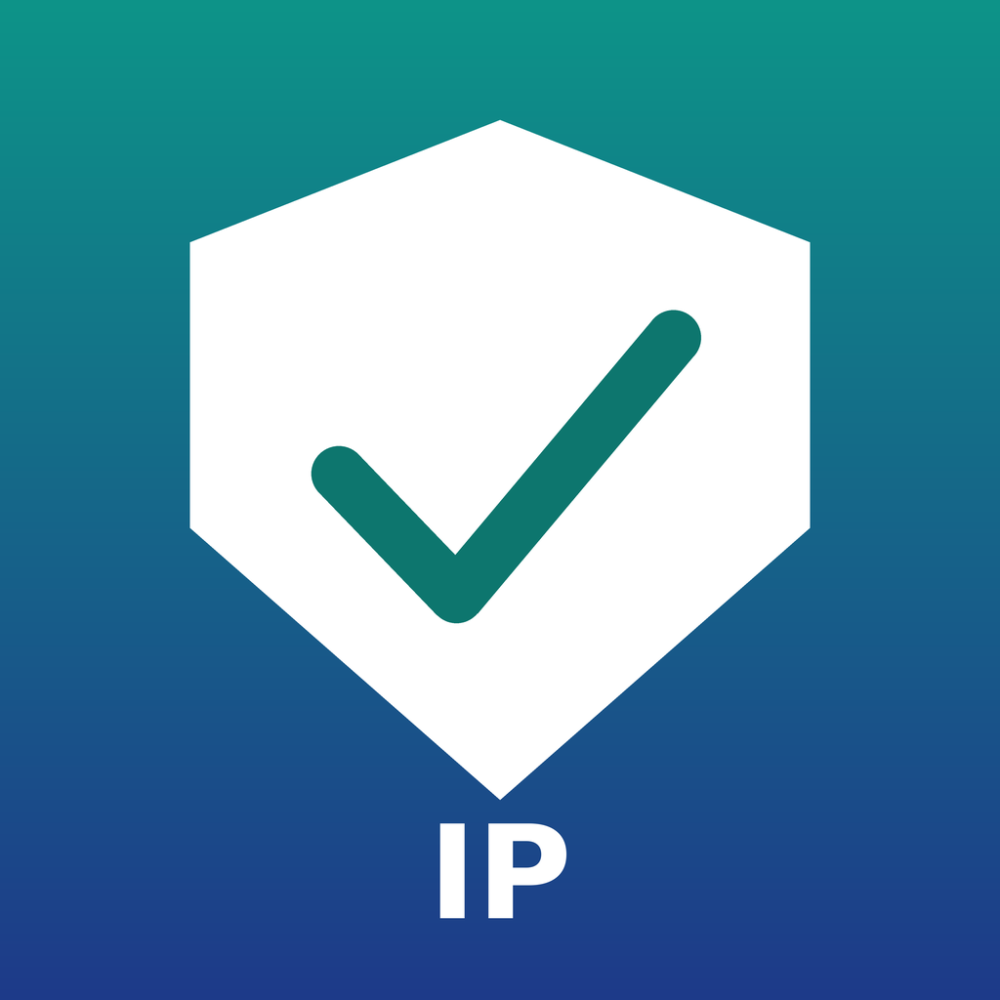

<div align="center">



# IP 体检

**一键检测 VPN / 代理节点的出口 IP 干不干净**


</div>

## 这是什么

买机场最怕两件事：节点吹自己是「原生家宽」，实际落地是被用烂了的机房 IP；IP 段早被各大平台拉黑，登什么封什么，自己还不知道。

**IP 体检**就是给手机装的一台「节点体检仪」：开着小火箭（Shadowrocket）等代理工具连上节点后打开本 App，十几秒就能看清这个出口的底细——是哪里的 IP、机房还是家宽、原生还是广播、风险有多高、流媒体和 AI 能不能用、速度怎么样。不开代理时测到的就是你自家宽带的出口，可以当基准分对比。

## 功能

### 🩺 IP 体检（纯净度检测）

- **出口信息**：出口 IP、国家 / 地区 / 城市、运营商、组织、ASN、IPv4 / IPv6
- **机房 / 家宽判定**：风险库标记 + ip-api 的 hosting 标记 + 已知云厂商名单，三重交叉判定，不靠单一数据源下结论
- **原生 / 广播判定**：同时向 5 个地理数据库问同一个 IP 的位置——答案一致是原生 IP，对不上就是疑似广播 IP（注册地与使用地不一致）
- **风险分**：接入 proxycheck 风险数据库（0–100，越低越好）
- **纯净度评分**：本地评分引擎给出 0–100 分和结论（纯净 / 良好 / 一般，有风险 / 风险高），**每一笔扣分都列出大白话理由**，不是黑箱打分
- **数据源状态**：每个接口的死活都标出来，某个源挂了其余源顶上，结论照样成立

### 🚀 测速

- 延迟、抖动、下载、上传四项，走 Cloudflare 官方测速端点
- 一次测速最多消耗约 54MB 流量；开着代理测到的就是节点的真实速度

### 📺 解锁检测（11 项）

逐个探测当前出口对以下服务的可用情况，按组展示（公开接口探测，各家风控会变，结果仅供参考）：

- **AI 服务**：ChatGPT · Claude · Gemini
- **流媒体**：Netflix · YouTube Premium · Disney+ · Spotify
- **社交**：TikTok · Instagram · Facebook · X（Twitter）

### 🕵️ 隐私泄漏检测（v1.1 新增）

- **DNS 泄漏**：查你的 DNS 实际在哪解析——出口在日本、DNS 却在中国解析，网站一眼就看穿真实地区
- **IPv6 双栈**：查有没有 IPv6 出口绕过代理直连出去，位置和 IPv4 对不上就是泄漏
- 体检跑完自动联动检测，结果写进报告

### 🎨 主题与设置（v1.1 新增）

- 五套渐变主题：海洋青、葡萄紫、蜜桃橙、森林绿、星空夜，设置页一键换肤
- 设置项：打开 App 自动体检、自动保存历史，数据源与隐私说明一页看清

### 🕘 历史记录

每次体检自动存档。把一家机场的节点挨个测完，回来一翻就知道哪个最干净（最佳节点带皇冠标记）；报告可一键复制 / 分享，跟机场客服沟通时直接甩给他；还能一键**导出全部记录的对比表**，哪个节点好一目了然。

## 纯净度评分规则

满分 100，逐项扣分（节选）：

| 情形 | 扣分 |
|---|---|
| 落地是机房 IP | −25 |
| 被标记为 VPN / 代理出口 | −20 |
| Tor 出口节点 | −55 |
| 风险数据库风险分 | 按比例扣，最高 −35 左右 |
| 被确认用作代理（在类型扣分之外） | −10 |
| 疑似广播 IP | −8 |
| 企业专线 | −5 |
| 家宽 + 低风险 + 无代理标记 | 保底按纯净档（≥92）计 |

结论分档：**85+ 纯净** · **70+ 良好** · **50+ 一般，有风险** · **50 以下 风险高，不建议用**

> 参考实测：某廉价机场的日本节点（AWS 东京机房）得分 **57**——日常浏览视频够用，但风险分 66 偏高，拿去登录 AI 服务容易撞风控。

## 数据源

全部为**免费、免 Key** 的公共接口，交叉验证后才下结论：

| 数据源 | 用途 |
|---|---|
| Cloudflare Trace | 出口 IP、落地国家 |
| ipwho.is | 出口 IP、地理位置、ASN / 运营商 |
| ip-api | 地理位置、hosting / proxy / mobile 标记 |
| proxycheck.io | IP 类型（家宽 / 机房 / VPN / Tor）、代理标记、风险分 |
| ipapi.co | 地理位置交叉验证 |
| ip.sb | 地理位置交叉验证 |
| speed.cloudflare.com | 下载 / 上传测速 |

## 安装

本项目发布的是**未签名 IPA**，需要用你自己的证书签名后安装：

1. 到 [Releases](../../releases) 下载最新版 `IPChecker.ipa`
2. 用任意签名工具自签安装（巨魔商店 / SideStore / AltStore / eSign / 牛蛙助手等均可；有个人证书的直接签）
3. 系统要求：iOS 15.0 及以上

## 使用

1. 先在代理工具里连上要测的节点（不连 = 测你自家宽带）
2. 打开「IP 体检」，自动开始检测；也可以切到「测速」「解锁」页单独测
3. 换节点重复检测，在「记录」页对比历史结果

## 隐私

- 不收集、不上传任何个人数据；评分全部在手机本地计算
- 检测时会访问上表中的公共接口（对方只能看到你当前的出口 IP，这正是要检测的对象）
- 历史记录只保存在手机本地，删 App 即清除

## 项目结构

单文件 SwiftUI 实现，无第三方依赖：

```
Sources/App.swift        全部代码（检测引擎 / 评分 / 测速 / 解锁 / 界面）
project.yml              XcodeGen 工程配置
Assets.xcassets          App 图标
.github/workflows/       GitHub Actions 云端打包（未签名 IPA）
```

## 路线图（后续版本考虑）

- WebRTC 泄漏检测
- 节点延迟批量巡测（一次测完整个订阅的速度）
- 检测结果桌面小组件

## 免责声明

检测结果来自第三方公共数据库与接口探测，各平台的风控策略随时变化，本 App 的评分与解锁结论**仅供参考**，不构成对任何 IP 可用性的保证。

## 开发者

**LengMo** · © 2026

## License

[MIT](LICENSE)

## 更新日志

### v1.1.0（2026-10-22）
- 新增隐私泄漏检测：DNS 解析地比对 + IPv6 双栈绕行检测，体检后自动联动
- 新增五套渐变主题（海洋青 / 葡萄紫 / 蜜桃橙 / 森林绿 / 星空夜）与设置页
- 解锁检测从 6 项扩到 11 项：新增 Spotify、TikTok、Instagram、Facebook、X，并按 AI / 流媒体 / 社交分组
- 体检页 UI 重做：渐变头卡 + 分数环 + 卡片化布局
- 历史记录新增一键导出对比表，最佳节点带皇冠标记

### v1.0.0（2026-10-22）
- 首版：六源交叉验证体检与评分、Cloudflare 测速、6 项解锁检测、历史记录与报告分享
